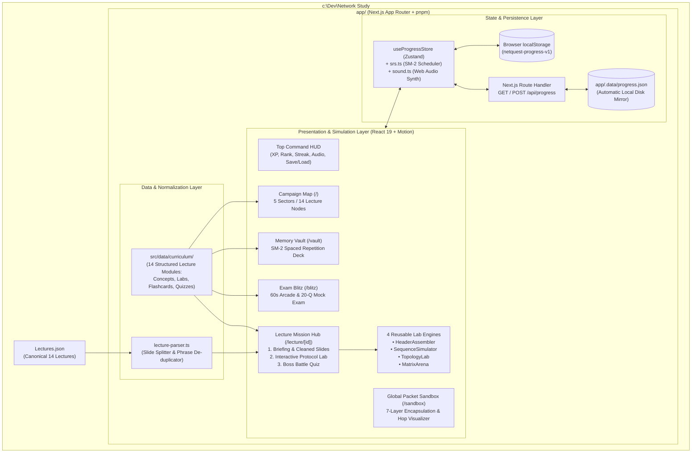

# System Architecture — NetQuest: Protocol Architect

## 1. High-Level Architecture Overview

In accordance with [ADR-001](./DECISIONS.md#adr-001-single-app-nextjs-app-topology-vs-separate-fastapi-service--aggregator-backend), **NetQuest: Protocol Architect** is architected as a self-contained **Next.js (App Router, TypeScript)** application located in `c:\Dev\Network Study\app` and managed with `pnpm`. Neither `service/` (FastAPI) nor `aggregator/` is used because all 14 lectures reside in a static 142 KB [`Lectures.json`](../Lectures.json) file and all simulations run at 60fps directly in the browser for single-user personal use.



---

## 2. Technology Stack (`app/package.json`)

| Category | Package / Tool | Version / Notes |
| :--- | :--- | :--- |
| **Framework** | `next`, `react`, `react-dom` | Next.js 15+ (App Router), React 19, TypeScript 5+ |
| **Package Manager** | `pnpm` | Workspace & dependency manager inside `app/` |
| **Styling** | `tailwindcss`, `clsx`, `tailwind-merge` | Utility-first dark mode styling |
| **Animations** | `motion` (or `framer-motion`) | Smooth 60fps packet animations, card flips, transitions |
| **Icons** | `lucide-react` | Network hardware, protocol, and gamification icons |
| **State Management** | `zustand` | Reactive store with `persist` middleware |
| **Audio Feedback** | Native Browser `AudioContext` | Zero-asset procedural synthesizer (`src/lib/sound.ts`) |
| **Testing** | `vitest`, `@testing-library/react`, `jsdom` | Fast unit and component test runner |

---

## 3. Directory Structure (`app/`)

```text
c:\Dev\Network Study\app\
├── .data/
│   └── progress.json                 # Auto-created local disk backup of user progress
├── public/                           # Static SVG badges/diagrams if any
├── src/
│   ├── app/
│   │   ├── layout.tsx                # Root dark-mode layout + Top Command HUD + Disk Sync initializer
│   │   ├── page.tsx                  # Campaign Command Center (5 Sectors, 14 Lecture Nodes, Quick Stats)
│   │   ├── globals.css               # Tailwind imports, custom scrollbars, cyber-grid backgrounds
│   │   ├── lecture/
│   │   │   └── [id]/
│   │   │       └── page.tsx          # 3-Stage Lecture Hub (Briefing, Protocol Lab, Boss Quiz, Source Slides)
│   │   ├── sandbox/
│   │   │   └── page.tsx              # Global 7-Layer Packet Journey & Encapsulation Simulator
│   │   ├── vault/
│   │   │   └── page.tsx              # SM-2 Spaced Repetition Flashcard Memory Vault
│   │   ├── blitz/
│   │   │   └── page.tsx              # Timed 60s Arcade & 20-Question Final Exam Simulator
│   │   └── api/
│   │       ├── lectures/
│   │       │   └── route.ts          # GET endpoint returning normalized Lectures.json + curriculum metadata
│   │       └── progress/
│   │           └── route.ts          # GET/POST local disk persistence to app/.data/progress.json
│   ├── components/
│   │   ├── layout/
│   │   │   ├── NavbarHUD.tsx         # Top bar: Navigation, XP bar, Rank badge, Streak, Audio toggle, Save Modal
│   │   │   └── SaveDataModal.tsx     # JSON Export / Import / Reset progress dialog
│   │   ├── lecture/
│   │   │   ├── ConceptBriefing.tsx   # Structured mental models, comparison tables, exam callouts
│   │   │   ├── SlideInspector.tsx    # Cleaned Lectures.json reader with instant search & term highlighter
│   │   │   └── BossQuiz.tsx          # Active recall quiz engine with combo multiplier & diagnostics
│   │   └── engines/
│   │       ├── LabDispatcher.tsx     # Routes a lecture's labConfig to the matching simulation engine
│   │       ├── HeaderAssembler.tsx   # Engine 1: Packet/Frame bit-field constructor & address calculator
│   │       ├── SequenceSimulator.tsx # Engine 2: Timeline handshake & sliding-window/FSM simulator
│   │       ├── TopologyLab.tsx       # Engine 3: WAN/LAN/Routing switchboard & network design lab
│   │       └── MatrixArena.tsx       # Engine 4: Protocol classification & cryptography trade-off arena
│   ├── data/
│   │   ├── index.ts                  # Exports unified 14-lecture curriculum registry
│   │   ├── sandbox-scenarios.ts      # Presets for the Global Packet Journey Sandbox
│   │   └── curriculum/
│   │       ├── sector1-foundations.ts # Lectures 1–2 structured modules
│   │       ├── sector2-area-nets.ts   # Lectures 3–4 structured modules
│   │       ├── sector3-internet.ts    # Lectures 5–7 structured modules
│   │       ├── sector4-transport.ts   # Lectures 8–10 structured modules
│   │       └── sector5-security.ts    # Lectures 11–14 structured modules
│   ├── lib/
│   │   ├── lecture-parser.ts         # Reads ../Lectures.json & normalizes duplicated slide text
│   │   ├── srs.ts                    # Pure SM-2 Spaced Repetition calculation functions
│   │   ├── sound.ts                  # Web Audio API sound effect synthesizer
│   │   └── utils.ts                  # cn() helper and formatting utilities
│   ├── store/
│   │   └── useProgressStore.ts       # Zustand state store (XP, mastery, SM-2 cards, disk sync)
│   └── types/
│       └── curriculum.ts             # Core TypeScript interfaces for lectures, labs, quizzes, and state
├── __tests__/
│   ├── lecture-parser.test.ts        # Verifies 14 lectures load & de-duplication cleans L4/L11/L14
│   ├── curriculum.test.ts            # Verifies all 14 lectures have complete cards, labs, flashcards, quizzes
│   ├── srs.test.ts                   # Verifies SM-2 interval & ease factor math
│   └── simulators.test.ts            # Verifies lab engine validation logic & progress store mutations
├── next.config.ts
├── package.json
├── tsconfig.json
└── vitest.config.ts
```

---

## 4. Core Domain Models (`src/types/curriculum.ts`)

```typescript
export type SectorId = 1 | 2 | 3 | 4 | 5;

export type OsiLayer = 1 | 2 | 3 | 4 | 5 | 6 | 7;

export interface RawLecture {
  index: number;
  title: string;
  content: string;
}

export interface NormalizedSlideBlock {
  id: string;
  heading?: string;
  bullets: string[];
}

export interface ConceptCard {
  id: string;
  title: string;
  layer?: OsiLayer;
  summary: string;
  keyPoints: string[];
  examTip: string;
  formulaOrSpec?: string; // e.g., "ATM Cell = 5B Header + 48B Data = 53 Bytes"
  comparisonTable?: {
    headers: string[];
    rows: string[][];
  };
}

// --- 4 Data-Driven Simulation Engine Configs ---

export interface HeaderAssemblerConfig {
  engine: 'header-assembler';
  title: string;
  scenario: string;
  targetProtocol: string;
  /** Ordered slots the user must populate or configure */
  slots: Array<{
    id: string;
    label: string;
    bitWidth: string;        // e.g., "48 bits", "16 bits", "32 bits"
    correctValue: string;    // e.g., "10101011 (SFD)" or "0x8100 (TPID)"
    description: string;
  }>;
  distractors: string[];
  /** Interactive parameter challenges (e.g., CIDR mask, EUI-64 MAC conversion, IPv6 compression) */
  parameterTasks: Array<{
    id: string;
    prompt: string;
    inputPlaceholder?: string;
    options: string[];
    correctOption: string;
    explanation: string;
  }>;
}

export interface SequenceSimulatorConfig {
  engine: 'sequence-simulator';
  title: string;
  scenario: string;
  actors: [string, string] | [string, string, string]; // e.g., ["Client", "Server"] or ["User", "RA", "CA"]
  steps: Array<{
    id: string;
    fromIndex: number;
    toIndex: number;
    label: string;           // e.g., "SYN (SEQ=x)" or "ICMPv6 Type 133 Router Solicitation"
    detail: string;
    stateAfter: string;      // e.g., "SYN_SENT" or "V(S)=3, V(R)=2"
    isInteractivePrompt?: boolean;
    options?: string[];      // Choices for the user to complete the missing/broken step
    correctOption?: string;
    explanation?: string;
  }>;
}

export interface TopologyLabConfig {
  engine: 'topology-lab';
  title: string;
  scenario: string;
  nodes: Array<{
    id: string;
    label: string;
    type: 'host' | 'switch' | 'router' | 'firewall' | 'wan-switch' | 'server' | 'wireless';
    x: number; // percentage 0-100
    y: number; // percentage 0-100
  }>;
  links: Array<{
    from: string;
    to: string;
    label: string;
  }>;
  challenges: Array<{
    id: string;
    targetNodeId: string;
    prompt: string;
    options: string[];
    correctOption: string;
    explanation: string;
  }>;
}

export interface MatrixArenaConfig {
  engine: 'matrix-arena';
  title: string;
  scenario: string;
  categories: Array<{
    id: string;
    title: string;
    subtitle: string;
  }>;
  items: Array<{
    id: string;
    text: string;
    correctCategoryId: string;
    explanation: string;
  }>;
}

export type LabConfig =
  | HeaderAssemblerConfig
  | SequenceSimulatorConfig
  | TopologyLabConfig
  | MatrixArenaConfig;

export interface Flashcard {
  id: string;
  lectureId: number;
  front: string;
  back: string;
  tag: string;
}

export interface QuizQuestion {
  id: string;
  lectureId: number;
  question: string;
  options: [string, string, string, string];
  correctIndex: 0 | 1 | 2 | 3;
  explanation: string;
  difficulty: 'core' | 'advanced';
}

export interface LectureModule {
  id: number;                // 1 to 14 matching Lectures.json index
  title: string;
  shortTitle: string;
  sectorId: SectorId;
  sectorName: string;
  estimatedMinutes: number;
  osiLayers: OsiLayer[];
  tagline: string;
  concepts: ConceptCard[];
  labConfig: LabConfig;
  flashcards: Flashcard[];
  quiz: QuizQuestion[];
}
```

---

## 5. `Lectures.json` Normalization Pipeline (`src/lib/lecture-parser.ts`)

Lectures 4, 11, and 14 in [`Lectures.json`](../Lectures.json) contain duplicated inline phrases produced by slide master/shadow extraction (for example: `"Local Area Networks. Local Area Networks Shantha Fernando Shantha Fernando"` or `"When a signal is being transmitted on the channel that When a signal is being transmitted on the channel that"`).

`lecture-parser.ts` must implement a deterministic normalizer:

```typescript
/**
 * Cleans slide-extraction phrase duplications (present in Lectures 4, 11, 14)
 * and splits slide bullet symbols (, , , , , •) into structured blocks.
 */
export function deduplicateSlideText(raw: string): string {
  // 1. Normalize whitespace
  let text = raw.replace(/\r\n/g, '\n').replace(/\s+/g, ' ').trim();

  // 2. Iteratively collapse immediate repeated multi-word or single-word phrases:
  //    e.g., "Foo Bar Foo Bar" -> "Foo Bar"
  //    Run 2 passes from longer phrase chunks down to 1-word repeats
  for (let pass = 0; pass < 3; pass++) {
    text = text.replace(/\b([A-Za-z0-9/\-.,()':;µ]+(?:\s+[A-Za-z0-9/\-.,()':;µ]+){1,12})\s+\1\b/gi, '$1');
    text = text.replace(/\b([A-Za-z0-9]{3,})\s+\1\b/gi, '$1');
  }
  return text;
}

export function parseLectureSlides(rawContent: string): NormalizedSlideBlock[] {
  const cleaned = deduplicateSlideText(rawContent);
  // Split on slide bullet markers:  (\uF06E),  (\uF0A2),  (\uF06C),  (\uE00A),  (\uF070), • (\u2022)
  const segments = cleaned
    .split(/[•]/g)
    .map((s) => s.trim())
    .filter(Boolean);

  // Group into digestible blocks of up to 5 bullets for the Source Slide Inspector
  const blocks: NormalizedSlideBlock[] = [];
  for (let i = 0; i < segments.length; i += 5) {
    blocks.push({
      id: `slide-block-${Math.floor(i / 5) + 1}`,
      bullets: segments.slice(i, i + 5),
    });
  }
  return blocks;
}
```

---

## 6. Spaced Repetition (SM-2) & Gamification Engine (`src/lib/srs.ts` & `src/store/useProgressStore.ts`)

### SM-2 Scheduling Algorithm
Each flashcard has an `SRSCardState`:
```typescript
export interface SRSCardState {
  cardId: string;
  interval: number;      // in days (0 = due immediately)
  repetitions: number;   // consecutive successful recalls
  easeFactor: number;    // default 2.5, minimum 1.3
  nextReviewAt: number;  // epoch timestamp (ms)
  lastRating?: 'again' | 'hard' | 'good' | 'easy';
  flaggedFromQuiz?: boolean;
}
```
When rated by the user (`rateCard(state, rating, nowMs)`):
- **`again` (Grade 1):** `repetitions = 0`, `interval = 0` (due immediately / 1 minute), `easeFactor = Math.max(1.3, state.easeFactor - 0.2)`.
- **`hard` (Grade 2):** `repetitions += 1`, `interval = state.interval === 0 ? 1 : Math.max(1, Math.round(state.interval * 1.2))`, `easeFactor = Math.max(1.3, state.easeFactor - 0.15)`.
- **`good` (Grade 3):** `repetitions += 1`, `interval = state.repetitions === 0 ? 1 : state.repetitions === 1 ? 3 : Math.round(state.interval * state.easeFactor)`, `easeFactor` unchanged.
- **`easy` (Grade 4):** `repetitions += 1`, `interval = state.repetitions === 0 ? 4 : Math.round(state.interval * state.easeFactor * 1.3)`, `easeFactor = state.easeFactor + 0.15`.

### Architect Ranks & XP Thresholds
- **Level 1 (`0 – 499 XP`):** *Packet Novice*
- **Level 2 (`500 – 1,499 XP`):** *Link Layer Technician*
- **Level 3 (`1,500 – 2,999 XP`):** *Routing Specialist*
- **Level 4 (`3,000 – 4,999 XP`):** *Transport & Crypto Engineer*
- **Level 5 (`5,000+ XP`):** *Principal Network Architect*

### XP Rewards
- Reading a Lecture Briefing (`markBriefingRead`): **+50 XP** (once per lecture)
- Passing an Interactive Protocol Lab (`markLabCompleted`): **+150 XP** (once per lecture)
- Boss Battle Quiz (`recordQuizScore`): **+30 XP** per correct answer × Combo Multiplier (+ **+100 XP** First-Time Boss Defeat bonus when scoring `>= 80%`)
- Reviewing an SM-2 Flashcard (`reviewCard`): **+10 XP** per card review
- Completing an Exam Blitz run (`recordBlitzScore`): **+15 XP** per correct answer
